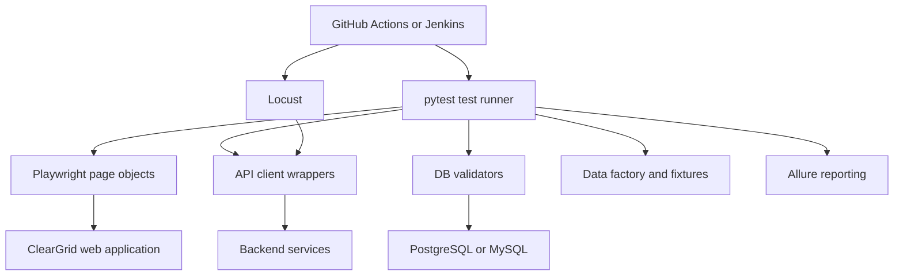

# ClearGrid QA Automation Framework Specification

## Document Control

| Field | Value |
| --- | --- |
| Status | Draft v1 |
| Audience | Engineering, QA, Hiring Panel |
| Primary Goal | Define a scalable automation framework for ClearGrid web, API, data, and performance validation |
| Technology Direction | Python-first |
| Last Updated | 2026-08-13 |

## 1. Objective

Build a unified Python-based quality automation framework that validates ClearGrid's critical FinTech workflows across the UI, service layer, and persistence layer. The framework must support fast pull request feedback, deeper end-to-end regression coverage, and reusable performance testing without fragmenting the automation stack.

The intent is to treat QA automation as a software product, not a collection of scripts. The design therefore emphasizes modularity, reuse, diagnosability, and CI readiness.

## 2. Problem Statement

ClearGrid's domain requires more than visual UI checks. A workflow can appear correct in the frontend while still failing at the API, database, or event-processing layer. For a FinTech platform, that gap is unacceptable because business-critical flows such as borrower servicing, settlements, payments, and state transitions must be validated with traceable evidence.

The framework must solve for the following:

- One automation stack for UI, API, DB, and load testing.
- Deterministic test data and environment isolation.
- Fast developer feedback in CI.
- Strong debugging evidence when failures occur.
- Coverage of both happy paths and system integrity checks.

## 3. Goals

- Provide a single Python test platform built around pytest.
- Support UI automation against the React or Next.js frontend using Playwright.
- Support direct API validation for microservices using requests and pydantic.
- Validate backend persistence and data correctness using SQLAlchemy.
- Reuse shared domain clients in both functional and performance tests.
- Run smoke coverage on every pull request and broader regression suites on a scheduled basis.
- Produce actionable reports with logs, screenshots, traces, and failure context.

## 4. Non-Goals

- Mobile native app automation in v1.
- Production monitoring or observability replacement.
- Full environment provisioning beyond the needs of test execution.
- Chaos testing or mutation testing in the initial release.
- Broad UI snapshot testing as a primary regression strategy.

## 5. Scope

### In Scope

- UI workflows for critical borrower, settlement, payment, and status-management journeys.
- API contract and business-rule validation for core backend services.
- Database assertions for persistence, state transitions, and auditability.
- End-to-end tests that combine UI, API, and DB validation.
- Performance tests for high-volume API scenarios using the same domain clients.
- CI quality gates, test reporting, and artifact publishing.

### Out of Scope

- Manual exploratory testing workflows.
- Security penetration testing tools.
- Performance testing of frontend rendering behavior.
- Production data mutation from automated tests.

## 6. Success Criteria

The framework will be considered successful when the following are true:

- Pull request smoke suites complete in 10 minutes or less.
- Full regression can execute unattended in CI with environment-specific configuration.
- Flaky test rate for the smoke suite stays below 3 percent across 20 consecutive runs.
- Critical workflows have traceable assertions at UI, API, and DB layers where applicable.
- New tests can be added by extending page objects, API clients, and fixtures rather than duplicating logic.
- Test failures include enough evidence for engineers to identify the failing layer quickly.

## 7. Architecture Overview

At a high level, the framework uses a modular layered design. Test orchestration is separated from UI interaction, API access, data generation, and database validation so that each layer can be tested independently or composed into full end-to-end flows.



### High-Level Component Map

| Layer | Technology | Responsibility |
| --- | --- | --- |
| Test Runner | pytest, pytest-xdist | Orchestrates execution, fixtures, tagging, parallelism, and result collection |
| UI Automation | playwright-python | Drives browser interactions, waits for app readiness, captures traces and screenshots |
| API Validation | requests, pydantic | Encapsulates HTTP flows, auth, schema validation, and service-level assertions |
| Data Integrity | SQLAlchemy | Validates persistence, state transitions, and downstream data consistency |
| Test Data | Faker, pytest fixtures | Generates isolated synthetic data and handles setup or teardown |
| Performance | locust | Exercises high-volume API scenarios using shared domain clients |
| Reporting | Allure, pytest logs | Publishes evidence for failures and trend visibility in CI |
| CI/CD | GitHub Actions or Jenkins | Runs suites automatically, blocks merges, and stores artifacts |

## 8. Repository Design

The repository follows two core patterns:

- Page Object Model for UI maintainability.
- API Client Wrapper pattern for backend reuse and readability.

```text
cleargrid-qa-automation/
├── src/
│   ├── api/
│   │   ├── base_client.py
│   │   ├── auth_client.py
│   │   └── settlement_api.py
│   ├── config/
│   │   └── settings.py
│   ├── data_factory/
│   │   └── borrower_factory.py
│   ├── db/
│   │   ├── postgres_client.py
│   │   └── validators.py
│   ├── models/
│   │   └── settlement_models.py
│   ├── pages/
│   │   ├── base_page.py
│   │   ├── login_page.py
│   │   └── dashboard_page.py
│   └── services/
│       └── test_context.py
├── tests/
│   ├── api/
│   ├── e2e/
│   ├── smoke/
│   ├── ui/
│   └── conftest.py
├── load_tests/
│   └── settlement_load.py
├── artifacts/
├── .github/workflows/
│   └── pr_quality_gate.yml
├── .env.example
├── pytest.ini
├── requirements.txt
└── README.md
```

## 9. Low-Level Design

### 9.1 Test Runner Layer

- pytest is the primary execution engine.
- Marks separate smoke, api, ui, e2e, and regression suites.
- Fixtures create browser sessions, auth tokens, test data, and DB connections.
- pytest-xdist enables safe parallel execution where tests are data-isolated.

### 9.2 UI Automation Layer

- Playwright is used for browser automation because of stable auto-waiting and strong trace support.
- Page objects expose business-level actions such as login, create settlement, search borrower, or approve state change.
- Selectors should prefer stable test IDs over brittle CSS paths.
- UI tests should assert only user-visible behavior unless paired with API or DB validation in e2e coverage.

### 9.3 API Client Layer

- Raw requests calls are not made inside test cases.
- Each domain area exposes a typed client wrapper that handles auth, headers, retries, and response parsing.
- Pydantic models validate response contracts and normalize payload access in tests.
- API clients are reusable in pytest and Locust to avoid duplicate protocol logic.

### 9.4 Database Validation Layer

- SQLAlchemy manages database connectivity and query execution.
- DB assertions are read-focused and used to verify persistence, status transitions, and referential consistency.
- Validation helpers should answer business questions such as whether a settlement record exists, whether a payment ledger entry was created, or whether an audit event was written.

### 9.5 Data Factory Layer

- Faker-based builders generate unique borrower and transaction data per test.
- Fixtures seed prerequisite state and clean up where necessary.
- Generated data must be deterministic enough to support debugging and parallel execution.

### 9.6 Performance Layer

- Locust simulates high-volume API traffic using the same API wrappers used by functional tests.
- Load scripts focus on service throughput, response times, and failure rates for high-risk workflows.
- Performance coverage is run separately from blocking pull request checks unless explicitly required.

## 10. Execution Model

### Suite Types

| Suite | Trigger | Purpose |
| --- | --- | --- |
| Smoke | Every pull request | Fast validation of core workflows and platform readiness |
| API Regression | Pull request and nightly | Contract, business-rule, and auth validation |
| UI Regression | Nightly or pre-release | Broader browser workflow coverage |
| E2E | Nightly or pre-release | Full-stack integrity checks across UI, API, and DB |
| Load | Scheduled or pre-release | Capacity and resilience validation |

### Environment Strategy

- Tests run against non-production environments only.
- Secrets are injected via CI secret stores and environment variables.
- Database access is restricted to approved lower environments with read-safe usage patterns.
- Test data is namespaced per run to avoid collisions across parallel jobs.

## 11. Core Workflows

### Example End-to-End Settlement Flow

1. Generate synthetic borrower data through fixtures or a factory.
2. Create or prepare prerequisite state through API setup helpers when faster than the UI.
3. Use Playwright to execute the user-facing settlement workflow.
4. Validate the API response or follow-up service state using the domain client.
5. Query the database to confirm durable persistence and audit entries.
6. Capture screenshots, traces, logs, and relevant identifiers on failure.

### Pull Request Quality Gate

1. Start test job in GitHub Actions or Jenkins.
2. Install dependencies and resolve environment configuration.
3. Run linting or static validation for framework code if included.
4. Execute smoke and selected API suites in parallel where safe.
5. Publish Allure results and failure artifacts.
6. Block merge if the quality gate fails.

## 12. Non-Functional Requirements

### Reliability

- Tests must avoid arbitrary sleep calls in favor of explicit or framework-native waits.
- Retry behavior is allowed only for known transient infrastructure boundaries, not for masking product bugs.
- Shared state between tests must be minimized to support parallel execution.

### Maintainability

- Test cases should read as workflows, not protocol details.
- Common logic belongs in page objects, API clients, validators, and fixtures.
- Naming should reflect business intent rather than UI implementation details.

### Observability

- Failed UI tests must capture screenshots and Playwright traces.
- API failures must log request identifiers, response payload summaries, and schema errors.
- DB validation failures must include enough context to identify the missing or incorrect record.

### Security and Compliance

- No production credentials or production data in test runs.
- Sensitive values must be masked in logs and reports.
- Audit-sensitive workflows should include backend verification, not only UI checks.

### Scalability

- The framework must support parallel pytest execution and separate CI stages.
- Load tests must reuse the API abstraction layer to avoid maintaining duplicate logic.

## 13. Risks and Mitigations

| Risk | Impact | Mitigation |
| --- | --- | --- |
| Brittle UI selectors | Flaky tests and false alarms | Enforce test IDs and page object ownership |
| Shared environment data collisions | Non-deterministic failures | Generate unique namespaced test data |
| API contract drift | Silent coverage gaps | Use pydantic schemas and contract assertions |
| Slow end-to-end suites | Poor developer adoption | Keep PR smoke small and push deep coverage to nightly runs |
| Weak failure evidence | Long debugging cycles | Capture traces, logs, screenshots, and DB context |

## 14. ClearGrid Requirement Mapping

| ClearGrid Expectation | Framework Response |
| --- | --- |
| Technical oversight and engineering mindset | Unified Python design with reusable abstractions, code review readiness, and modular architecture |
| API and data integrity | Service-layer validation plus direct DB assertions for critical workflows |
| CI/CD and shift-left | Pull request quality gates, automated artifact publishing, and merge blocking |
| Handling flakiness | Playwright auto-waiting, deterministic fixtures, limited retries, and strong diagnostics |
| Performance and scalability | Locust-based load testing reusing shared API client logic |

## 15. Delivery Plan

### Phase 1: Foundation

- Create repository skeleton and environment configuration.
- Implement base pytest fixtures, Playwright setup, API base client, and DB connection helpers.
- Stand up smoke reporting in CI.

### Phase 2: Core Coverage

- Add critical API and UI workflows.
- Implement first end-to-end data-integrity scenarios.
- Harden test data management and artifact capture.

### Phase 3: Scale and Confidence

- Add nightly regression orchestration.
- Introduce Locust scenarios for key high-volume services.
- Track flaky tests and optimize execution time.

## 16. Acceptance Criteria

- A single repository can execute UI, API, E2E, and load-test entry points.
- Smoke suites run automatically in CI and can block merges.
- At least one critical workflow is validated across UI, API, and DB layers.
- Shared domain clients are reused between pytest suites and Locust.
- Failure artifacts are generated automatically and published by CI.
- The framework structure is clean enough for another engineer to extend without rewriting core utilities.
